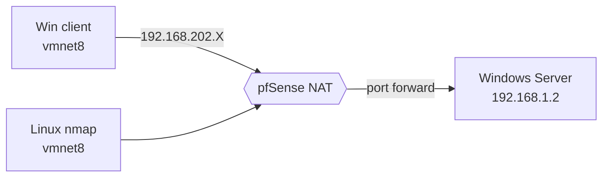

# Firewall Lab
Back to [[NETW1111]]

> [!info] Overview
> Use **NAT port forwarding** and firewall rules on a **pfSense** router to give an external client access to HTTP, DNS and FTP on an internal Windows Server, then verify with network tools. Out of **20**.

## Setup
| VM | Network |
| --- | --- |
| pfSense router | WAN on vmnet8 (`192.168.202.X`), LAN `192.168.1.1` on vmnet4 |
| Windows Server | vmnet4, `192.168.1.2` |
| Windows client | vmnet8 (external) |
| Linux VM | vmnet8 (scanning) |



## Part 1 - ICMP proof of concept
* pfSense web UI → **Firewall → NAT** → new rule forwarding **ICMP** to the server
* ICMP is its own protocol (not TCP/UDP) - pick the right protocol
* **Save → Apply Changes**
* Ping the WAN IP from the client. To prove the *server* (not pfSense) answers: block inbound on the server's firewall and watch the pings fail

> [!tip] Lab method
> 1. Use the correct protocol 2. Make sure the rule is **applied** 3. **Test** that it works *and* reaches the right target. Be skeptical - prove it.

## Part 2 - HTTP
* NAT rule: **TCP 80** → server
```powershell
Test-NetConnection -ComputerName "192.168.202.XXX" -Port 80 -InformationLevel "Detailed"
```
* Browse to `http://192.168.202.XXX` (not https) → IIS welcome page

## Part 3 - DNS
* NAT rule: **UDP (and TCP) 53** → server
* `nslookup firstname.netw1111.ca 192.168.202.XXX` - must query the **WAN IP**, the default vmnet8 DNS knows nothing about the internal zone
* Set the client's **primary DNS** to the WAN IP
* Browsing to the internal name fails - it resolves to the **internal** IP `192.168.1.2`, which the client can't reach
* Fix: add a new **A record** (`lastname.netw1111.ca`) pointing at the **router's WAN IP** → separate internal and external names (split naming)

## Part 4 - FTP
* NAT rule: **TCP 21** (command channel) → server
* Client firewall: allow FileZilla any port → **Active FTP** works (server connects back to the client)
* **Passive FTP** needs a fixed data port range:
	1. Pick a 100-port range (based on your student number), e.g. `3456-3556`
	2. NAT rule forwarding that **TCP range** → server
	3. IIS → server → **FTP Firewall Support** → set the **data channel port range** and the **external IP** (router WAN)
* Connect with FileZilla in Passive mode
> [!warning] Both the FTP server config **and** the NAT rule must match, or FTP fails or works intermittently. See [[FTP#Ports and modes]]

## Part 6 - Scanning (Linux)
```bash
nmap 192.168.202.XXX          # service/port scan - should show 21, 53, 80
nmap -sV 192.168.202.XXX      # version scan - IIS, Microsoft DNS, Microsoft ftpd
nmap -sU -p 53 192.168.202.XXX
```

## Rubric (/20)
| Item | Marks |
| --- | --- |
| Test-NetConnection on 80 | 1 |
| Browser visit by IP | 1 |
| DNS query via nslookup | 1 |
| Client primary DNS = WAN IP | 1 |
| Lastname FQDN resolves to WAN IP | 1 |
| Lastname FQDN loads the site | 1 |
| Active FTP via FileZilla | 1 |
| Passive FTP via FileZilla | 1 |
| nmap service scan shows HTTP/DNS/FTP | 3 |
| nmap version scan shows HTTP/DNS/FTP | 3 |
| 5 NAT rules (ICMP, HTTP, DNS, FTP 21, FTP data range) - only needed ports | 6 |

Related: [[Firewalls]], [[HTTP]], [[DNS]], [[FTP]], [[Packet Sniffing]]
