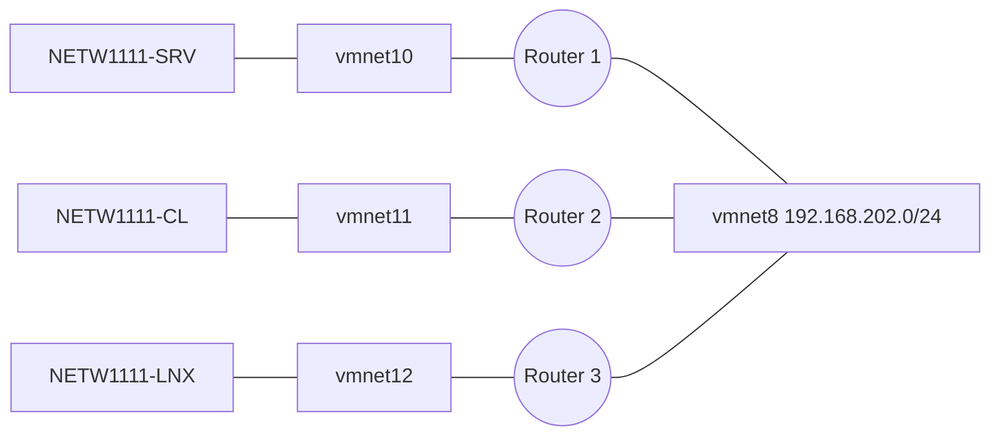

# Switching and Routing Lab
Back to [[NETW1111]]

> [!info] Overview
> Connect **three subnets** with **three routers** that talk to each other over **vmnet8 (192.168.202.0/24)**. Each subnet has one VM. Worth **20%**, marked out of **50**.

## Requirements
* Don't change vmnet8. Routers use static IPs on vmnet8 (4th octet between 1 and 100)
* Use **one private class A (`10.0.0.0`) or class B (`172.16.0.0`)** network and subnet it yourself
	* 3rd octet must be **1XX** (XX = last two digits of your student number), e.g. `10.0.1XX.0`
* **All IPs static**
* Virtual switches: **vmnet10, 11, 12** - host-only, **DHCP disabled**, **no host virtual adapter**. vmnet8 keeps DHCP + virtual adapter
* Each router: **2 NICs**, one on vmnet8
* vmnet10/11/12 each host one of NETW1111-SRV, NETW1111-CL, NETW1111-LNX (single NIC each)
* Every host must **ping** and **traceroute** every other host (allow ICMP echo through firewalls)
* Static routes and/or default gateways are fine. No Internet access expected (NAT comes later)
* Routers can be Windows or FreeBSD (or a mix)

## Topology


## Deliverables
* **Network diagram** - all subnets, vmnets, IPs and masks, correct icons (see [[Network Diagrams]])
* Traceroutes from each VM to the other two (each should show **3 hops**: source subnet → vmnet8 → destination)
* `ipconfig /all` (Windows) / `ifconfig -a` (Linux, FreeBSD) for every VM and router
* `route print` (Windows) / `netstat -4 -r -n` (FreeBSD) for each router

## Rubric (/50)
| Item | Marks |
| --- | --- |
| Diagram: 3 hosts, 3 routers (icons, IPs, masks) + 4 switches with vmnet IDs | 26 |
| Traceroutes between all non-router VMs | 18 |
| 2 static routes per router (or 1 static + default gateway) | 6 |

## How it works
* Each router knows its two directly connected networks; it needs **static routes** to the other two subnets via the other routers' vmnet8 IPs
* Each client's **default gateway** = its router's IP on the same vmnet (see [[Routing#Routing clients and the default gateway]])

```powershell
# Windows router - enable routing, then add routes to the other subnets
Set-NetIPInterface -Forwarding Enabled
route -p add 10.0.1XX.64 mask 255.255.255.192 192.168.202.12
route print
```
```sh
# FreeBSD router
sysctl net.inet.ip.forwarding=1          # gateway_enable="YES" in /etc/rc.conf to persist
route add -net 10.0.1XX.64/26 192.168.202.12
netstat -4 -r -n
```

## Resources
* [FreeBSD handbook - routing](https://docs.freebsd.org/en/books/handbook/advanced-networking/#network-routing)
* [Windows `route` command](https://learn.microsoft.com/en-us/windows-server/administration/windows-commands/route_ws2008)
* Related: [[Subnetting]], [[Subnetting Considerations]]
