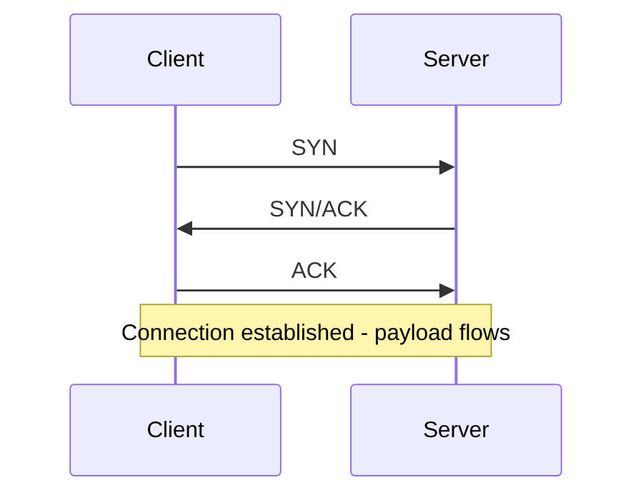

# TCP/IP and Transport Protocols
Back to [[NETW1111]] · Prev: [[Ethernet, ARP and ICMP]] · Next: [[Routing]]

## The TCP/IP suite
* Collection of protocols the internet relies on, named after **TCP** and **IP**
* They ensure delivery and reliability between networks and between nodes
* Created *before* the [[OSI Model]] - 4 layers instead of 7, so there's no one-to-one mapping

| OSI layers | TCP/IP layer | Protocols |
| --- | --- | --- |
| Application, Presentation, Session | **Application** | FTP, DNS, HTTP, DHCP, SSH, RDP, SSL/TLS, SMTP |
| Transport | **Transport** | TCP, UDP |
| Network | **Internet** | IP (v4/v6), ARP, ICMP, IGMP |
| Data Link, Physical | **Network Interface** | Ethernet, Frame Relay, ATM |

* **Application** - programs, APIs, encryption, encoding, sync
* **Transport** - reliable connections, flow control, fragmentation/reassembly, error correction
* **Internet** - routing and logical addressing; picks the delivery path and reacts to failures
* **Network Interface** - transmission and error correction of frames over physical media; Ethernet and MAC addressing

## IP - Internet Protocol
* Handles **routing between networks**
* **Connectionless** - no verification of a connection before sending (that's left to TCP/UDP)
* IPv4 = 32-bit addresses, IPv6 = 128-bit
> [!TIP]
> IP is *how data gets to its destination*; TCP is *what makes sure it arrived intact and coherent*

## TCP - Transmission Control Protocol
* Reliable connection between two nodes - ensures they can exchange data **before** real data is sent
* HTTP, POP3, FTP, SMTP encapsulate their packets inside TCP - TCP is the **envelope**
* Features: reliability, delivery guarantees + data integrity, connection handling, identifies the app protocol (port), buffering, segmentation and reassembly, congestion control
* Limitations: complicated, longer/more complex header, **slow start**

### TCP header fields
| Field | Meaning |
| --- | --- |
| Source port | Sending port number |
| Destination port | Receiving port number |
| Sequence number | Order of the packet for reassembly |
| Acknowledgement number | Last packet received by the sender |
| Data offset | Header size |
| Flags | 9 bits of connection state |
| Window size | Bytes the sender is willing to receive |
| Checksum | Error checking on header + payload |

### TCP flags
* **SYN** - initiates a connection (first packet)
* **ACK** - acknowledgement, set on every packet after the first
* **RST** - reset the connection
* **FIN** - terminate the connection
* **PSH** - push buffered data to the waiting application

### 3-way handshake

* Teardown uses **FIN** / **ACK** exchanges from both sides

## UDP - User Datagram Protocol
* **Connectionless** - simplest kind of transport
* No handshake, no delivery verification, no buffering, no segmentation - only a checksum + port
* Up to ~40% faster than TCP; apps provide their own timeouts/retries
* Used when **speed > reliability**: streaming media, **DNS**, **DHCP**, multicast

| | TCP | UDP |
| --- | --- | --- |
| Connection | Connection-oriented (handshake) | Connectionless |
| Reliability | Guaranteed, ordered, retransmits | Best effort |
| Header | Large/complex | Small/simple |
| Speed | Slower | Faster |
| Examples | HTTP, FTP, SSH, SMTP | DNS, DHCP, streaming |

## Ports
* 16-bit number identifying a process/service → **65,535** ports
* **1-1024** = well known ports (non-system users can't claim them)
* **Above 1024** = dynamically allocated (temporary) ports
* Every connection uses a **source port** (client process) and **destination port** (listening server process)

### Well-known ports
| Port | Protocol | Transport | Description |
| --- | --- | --- | --- |
| 20 | FTP data | TCP | FTP data transfer channel |
| 21 | FTP control | TCP | FTP command channel |
| 22 | SSH | TCP | Secure Shell |
| 25 | SMTP | TCP | Sending mail |
| 53 | DNS | TCP & UDP | Domain Name System |
| 67 | DHCP server | UDP | DHCP server port |
| 68 | DHCP client | UDP | DHCP client port |
| 80 | HTTP | TCP | Web |
| 110 | POP3 | TCP | Mail retrieval |
| 443 | HTTPS | TCP | HTTP over SSL/TLS |

## Transmission types
* IPv4: unicast, broadcast, multicast · IPv6: unicast, multicast, anycast
* **Unicast** - one to one (like a phone call). Most internet traffic
* **Broadcast** - one to all on the network/subnet (like a megaphone)
	* Can't use TCP (too many handshakes) → **UDP**, so packets can drop
	* Burdens switches
* **Multicast** - clients "tune in" by joining a multicast address (like a radio channel)
	* Switches only send to participating ports. Also UDP. Used for webcasting and system deployment

## Links
* Videos: [TCP vs UDP](https://www.youtube.com/watch?v=uwoD5YsGACg) · [Network Ports Explained](https://www.youtube.com/watch?v=g2fT-g9PX9o)
* Activity: *Exercise - TCP-IP* (uses PortQryUI and portlistener)
