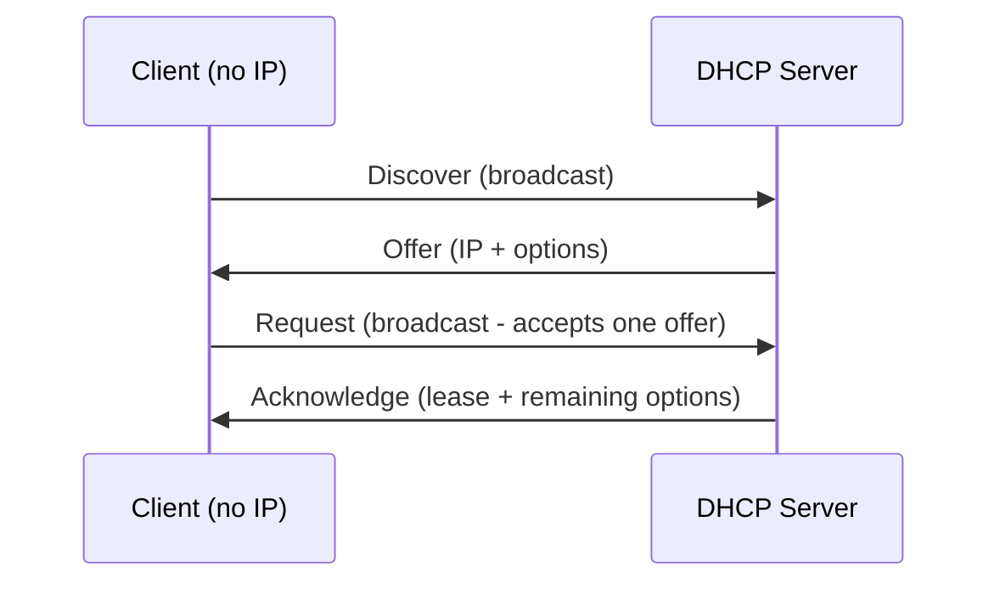

# DHCP
Back to [[NETW1111]] · Prev: [[DNS]] · Next: [[SMB]]

* **Dynamic Host Configuration Protocol** - gives clients an IP from a **pool** with no human intervention
* Random assignment or based on MAC address
* Lets many clients share fewer addresses (like library books)
* Operates at the **LAN** level (broadcasts) - **UDP 67 (server) / 68 (client)**

## What the client receives
* IP address + subnet mask
* Default gateway
* DNS server(s)
* WINS server
* Domain name
* Lease duration

## DORA

1. **Discover** - client broadcasts (it has no IP yet)
2. **Offer** - servers offer an IP + config. Client takes the **fastest** responder
3. **Request** - broadcast, so other offering servers know they weren't picked
4. **Acknowledge** - lease duration + remaining options; client checks for conflicts with ARP (IPv4) / ND (IPv6)

## Relay agents
* Broadcasts don't cross routers → DHCP is LAN-only
* A **DHCP relay agent** (on a router/switch) forwards requests via **unicast** to a DHCP server on another network

## Leases
* Renewal attempted at **50%** of the lease, then **75%**, **87.5%**, then every 2 minutes
* If never renewed, client gives up the IP and restarts DORA
* Expired leases return to the pool

```powershell
ipconfig /release     # IPv4
ipconfig /renew
ipconfig /release6    # IPv6
ipconfig /renew6
```
* No admin rights needed. Useful to pick up config changes quickly when testing

## Reservations
* Always give the same IP to a device (servers, printers, IP phones) by tying it to the **MAC address**
* "Static DHCP IP" = a reservation

## DHCP + DNS
* In Windows domains, DHCP tells DNS about new leases → DNS creates the A record
* Stale/wrong entries → delete the DNS record and let it re-register

## Troubleshooting
| Symptom | Cause / fix |
| --- | --- |
| Client gets `0.0.0.0` | DHCP server active but **unconfigured** - configure it or escalate |
| Client gets `169.254.x.x` (**APIPA**) | Can't reach a DHCP server. Check physical connectivity; if many clients affected → server/switch/router |
| IP address conflict | Someone set a static IP in the pool. Use ARP to find the MAC → inventory. Reserve the IP meanwhile |
| Renew works but can't ping out | Bad options from the server: bad **gateway** (can't ping DG), bad **DNS** (can ping DG but no names), bad **mask** |
| Unknown address range | Multiple / **rogue DHCP server** - fastest wins. Find it with ARP (MAC) or DNS and remove it |
| No more addresses | **Scope exhausted** - expand the range |
| DHCPNAK | Renewing an expired lease, IP not in subnet, or VLAN issue |

## Links
* [DHCP](https://en.wikipedia.org/wiki/Dynamic_Host_Configuration_Protocol) · [RFC 2131](https://datatracker.ietf.org/doc/html/rfc2131) · [Rogue DHCP](https://en.wikipedia.org/wiki/Rogue_DHCP)
* Video: [DHCP Explained](https://www.youtube.com/watch?v=e6-TaH5bkjo)
* Activity: *Exercise - DHCP*
* See also: [[DHCP Server Role]] (SYSA1010)
