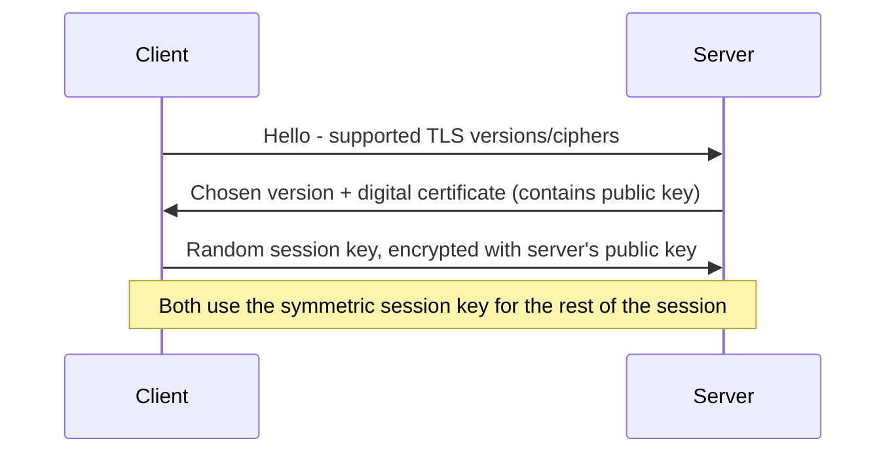

# SSL/TLS
Back to [[NETW1111]] · Prev: [[SSH]] · Next: [[Wireless]]

* **TLS** (Transport Layer Security) succeeded **SSL** (Secure Sockets Layer, Netscape) - people still say "SSL"
* Encrypts web traffic (**HTTPS**) and can make any insecure protocol secure by creating an encrypted tunnel

## History
| Year | Event |
| --- | --- |
| 1995 | Netscape creates SSL (2.0) for e-commerce |
| 1996 | SSL 3.0 |
| 1999 | **TLS 1.0** - IETF takes over |
| 2015 | SSL 3.0 officially deprecated after a serious bug |
| 2018 | **TLS 1.3** (RFC 8446) - current |

## Uses
* Encrypting web connections and **verifying the server's** authenticity (certificates)
* Client authentication is possible but uncommon - users usually log in with a username/password (+ MFA), e.g. webmail, online banking

| Protocol | Secure port | Notes |
| --- | --- | --- |
| HTTPS | 443 | HTTP is 80 |
| FTPS | 990 (implicit) / 21 (explicit) | Data channel encryption optional |
| RDP | 3389 | Same port encrypted or not |
| SMTP | 587 (465, 2525) | Unencrypted on 25 |
| POP3 | 995 | Unencrypted on 110 |
| IMAP | 993 | Unencrypted on 143 |

## Certificates and PKI
* **PKI** (Public Key Infrastructure) = everything needed to issue and check certificates
* **Certificate Authorities (CAs)** - trusted third parties (e.g. DigiCert/Verisign, GoDaddy, Let's Encrypt) vouch for a server's identity
* Certificates **always expire**; you pay for a fixed term

| Type | Trusted by | Use |
| --- | --- | --- |
| **Public CA** | Everyone (preloaded in browsers/OSes) | Externally facing servers |
| **Enterprise CA** | Only enterprise-managed clients | Internal systems (easy to automate on Windows/AD) |
| **Self-signed** | No one by default - "issuing your own driver's licence" | Labs/testing only, never production |

## Certificate warnings
| Warning | Meaning | Risk if ignored |
| --- | --- | --- |
| **Untrusted CA** | Issuer isn't in the client's trust store (enterprise/self-signed) | Server impersonation |
| **Expired / not yet valid** | Validity period issue (usually expiry) | Less serious, but could allow impersonation |
| **Name mismatch** | FQDN not in the Subject or **Subject Alternative Name (SAN)** fields. Wildcards like `*.nait.ca` cover any host on the domain | You may be sending passwords to the wrong server |
| **Revoked / status unavailable** | Cert is on the CA's **Certificate Revocation List (CRL)**, or the client couldn't check | Compromised cert could be in use |

* Browsers usually let you continue anyway; many other apps refuse

## TLS negotiation

* Only the server's **private key** can decrypt what its **public key** encrypted - the private key is never shared
* Public key encryption is **slow**, so it's only used to exchange a fast **symmetric session key**
* Clients usually don't have key pairs, which is another reason a shared session key is used

## Troubleshooting
* TLS protocols use **different ports** than their plain versions → update firewall rules
* Old clients may try **deprecated TLS/SSL versions** that the server has disabled
* Investigate every certificate warning

## Links
* [TLS](https://en.wikipedia.org/wiki/Transport_Layer_Security) · [Why use TLS 1.3](https://www.cloudflare.com/learning/ssl/why-use-tls-1.3/) · [OWASP TLS cheat sheet](https://cheatsheetseries.owasp.org/cheatsheets/Transport_Layer_Security_Cheat_Sheet.html)
* Video: [SSL, TLS, HTTP, HTTPS Explained](https://www.youtube.com/watch?v=hExRDVZHhig)
* Activity: *Exercise - TLS* (uses Fiddler)
