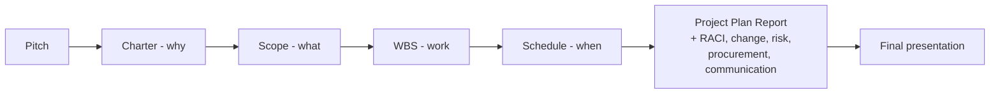

# 🔴 PMIT1027 - IT Project Essentials
Back to [[README|Home]]

> [!NOTE]
> Info gathered and simplified from the PMIT1027 slides in Brightspace, plus the assessment handouts.

## Lessons
| Week | Topic |
| --- | --- |
| 1 | [[What is a Project]] |
| 2 | [[Team Dynamics]] |
| 3 | [[Successful Projects and Project Ideas]] · [[The Project Pitch]] |
| 4 | Pitch work period / presentations |
| 5 | [[Project Charters]] · [[Executive Summaries]] |
| 6 | [[Project Scope]] |
| 7 | [[Work Breakdown Structure]] |
| 8 | WBS work period |
| 9 | [[Gantt Charts and Critical Path]] |
| 10 | [[Project Planning Phase and RACI]] |
| 11 | [[Change and Risk Management]] |
| 12 | [[Procurement and Communication Planning]] |
| 13-15 | Budget/ROI, final presentation and report |

## Assessments
| Assessment | Weight |
| --- | --- |
| [[Team Norms Contract]] | 5% |
| [[Reflective Journals]] (×3) | 15% |
| [[Project Pitch]] | 10% |
| [[Project Charter]] | 10% |
| [[Project Scope Statement]] | 10% |
| [[Work Breakdown Structure Assessment]] | 10% |
| [[Project Schedule]] | 10% |
| [[Final Project Plan Presentation]] | 10% |
| [[Project Plan Report]] | 20% |

## How the documents build on each other

