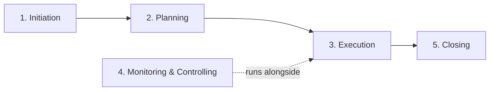

# What is a Project?
Back to [[PMIT1027]] · Next: [[Team Dynamics]]

## Course outcomes
* Compile the documents to **initiate** a project
* Outline **scope** by defining project boundaries
* Construct a **Work Breakdown Structure**
* Model the project in a **planning tool** (MS Project)
* Apply communication skills for **teamwork**

## Course framework (group semester project)
1. **Project Charter** (+ Pitch presentation)
2. **Project Scope**
3. **WBS + Project Schedule**
4. **Project Plan** (+ final presentation)

* Tools: **MS Project** and **Visio** (Windows only) from Azure Dev Tools for Teaching. On a Mac: VMware Fusion / Parallels / Boot Camp, or RDP to a PC

## What is a project?
| Characteristic | Meaning |
| --- | --- |
| **Unique** | Produces something new - a one-time activity |
| **Clear start and end** | Can last years, but can't go on forever |
| **Constraints** | Scope, time, budget, quality (and people/resources) |
| **Temporary team** | Needs planning and coordination |
| **Not business as usual** | A **process** is routine, predefined, repeated (e.g. expense approvals) |

* Projects can be huge (Hoover Dam) or tiny (a weekend pathway), many people (a wedding) or just you

### Project or business as usual?
| Scenario | Answer |
| --- | --- |
| Lisa processes payroll every second Friday | **BAU** - routine, repeating |
| Lisa's team implements a new payroll system over a year (migrate data, train staff, retire old system) | **Project** |
| Steven provides tier 3 ERP/network support, password changes, escalations | **BAU** |
| Steven's team migrates all users from GroupWise to Microsoft 365 (vendors, planning, training, testing) | **Project** |
| Ashley's **annual** security audit, with new compliance requirements, updated tools and external auditors each year | **Both** - the recurring audit is BAU, but each year's new requirements/tools can make it a project. Repetition alone doesn't decide it - **uniqueness and a defined end** do |

## The project life cycle - 5 stages

| Stage | Activities | Deliverable |
| --- | --- | --- |
| **1. Initiation** | Define purpose + feasibility, identify stakeholders, seek approval, document objectives + constraints | **Project Charter** |
| **2. Planning** | Detailed roadmap - scope, schedule, resources, risks, communication plan, break work into tasks (WBS) | **Project Plan** |
| **3. Execution** | Kick-off meeting, assign resources, produce deliverables, manage quality and communication | The project's deliverables |
| **4. Monitoring & Controlling** | *Concurrent with execution* - track progress, monitor scope/budget/schedule/quality, manage risks, control change | **Status reports, KPIs** |
| **5. Closing** | Formal completion, stakeholder acceptance, lessons learned, archive documents, hand over, release resources | **Final project report** |

* Course's classic version: Initiation (visioning, charter) → Definition (scope, modelling) → Planning (project plan) → Execution → Close/Evaluation

### Activity - housewarming party
* List the tasks and classify them by stage; note it's unique, has start/end dates, deliverables (food, invites, decorations), constraints (time, money, people) and risks (no-shows, food runs out)

## Why project management?
* Without it projects risk **failure**, **delay** and **going over budget**

## Success factors
* Clear scope and purpose · good communication · effective leadership · risk awareness

## Key players
* **Stakeholders:** sponsor, project manager, users, suppliers - plus SMEs and technicians
* **PM skills:** leadership, industry knowledge, communication, problem-solving, negotiation, teamwork
	* Debate: does a PM need to be an industry expert, or are strong PM skills enough?

## Links
* [Top 10 most expensive mega projects](https://www.youtube.com/shorts/pK3sR24WNnY) · [A day in the life of a project manager](https://www.youtube.com/watch?v=AzQ3Xso7sLA)
* APA Template (7th ed.) and [MyBib citation generator](https://www.mybib.com/tools/apa-citation-generator)
