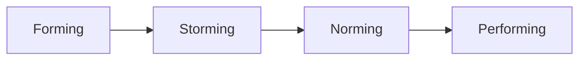

# Team Dynamics
Back to [[PMIT1027]] · Prev: [[What is a Project]] · Next: [[Successful Projects and Project Ideas]]

## What is a team?
* A group of people with a **full set of complementary skills** required to complete a task, job or project
* People at a bus stop aren't a team - no shared goal, no complementary roles

## Google's Project Aristotle - 5 dynamics of great teams
* 2012 study: 180 teams, 200+ interviews, 250+ attributes - looking for the "perfect team" formula

| Dynamic | Meaning | Example / risk |
| --- | --- | --- |
| **Psychological safety** ⭐ | Safe to take risks, ask questions, admit mistakes, share ideas without embarrassment | **#1 predictor** of team success. Junior IT staff can speak up without ridicule |
| **Dependability** | Trust each other to deliver quality work on time | One member skips their section → the whole team suffers |
| **Structure & clarity** | Clear goals, roles, execution plans | No one knows who's writing the final report = chaos |
| **Meaning** | Work is personally important (helping others, growth, career skills, pride) | |
| **Impact** | The work has purpose and value | Without it → disengagement and **silos** (teams only see their piece → duplicated work, miscommunication, delays). E.g. helpdesk never learns what happened to a Tier 2 escalation |

> "What really mattered was less about **who** is on the team, and more about **how the team worked together**." - Harvard Business Review, 2016

* Teams innovate faster, catch mistakes sooner, find better solutions, and report higher job satisfaction
* Case study: the **1990s Chicago Bulls** - talent plus coordination; the whole greater than the parts

## Tuckman's stages of team formation

| Stage | What happens |
| --- | --- |
| **Forming** | Polite introductions, excitement, uncertainty |
| **Storming** | Conflict and disagreement while roles are figured out |
| **Norming** | Rules, routines and trust established |
| **Performing** | Effective work toward goals, synergy |
* **Storming is normal** - the goal is to reach norming/performing fast. The **Team Norms Contract** helps

## The semester group project
* Plan (not do) a **simple, familiar, not-too-technical** make-believe project - a case study in planning
* Examples: game launch party, student gaming tourney, small gaming lounge, cosplay/esports night, deck/shed/fence, home theatre install, podcast
* Teams are **assigned** (like real workplaces) - diversity of skills, adaptability, teamwork practice

| Deliverable | Weight |
| --- | --- |
| Norms contract | 5% |
| Project pitch | 10% |
| Project charter | 10% |
| Project scope | 10% |
| Work breakdown structure | 10% |
| Project schedule | 10% |
| Project plan report | 20% |
| Final presentation | 10% |
| 3 × reflective journals (individual) | 5% each |

## Group work best practices
* Show up prepared and on time
* Listen actively; give everyone a voice
* Respect roles (leader, note-taker)
* Communicate clearly and directly
* **Be accountable** - deliver what you commit to

## Activities
* **Silent planning challenge** - plan a 5-step event using only chat/emoji: shows how much communication tools and clarity matter
* Pick a team name (Ctrl Freaks, LAN of Milk and Honey, Pasta La Vista, Better Call Scroll)
* Brainstorm 2-3 norms tied to the 5 dynamics → [[Team Norms Contract]]

## Journal 1 prompts
* What did you learn about effective teamwork?
* Which of the 5 dynamics will matter for your group, and why?
* How did forming your team go?
* What norms do you personally value?
