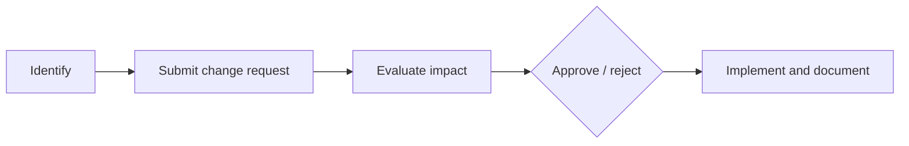

# Change and Risk Management
Back to [[PMIT1027]] · Prev: [[Project Planning Phase and RACI]] · Next: [[Procurement and Communication Planning]]

# Change management
| Project change management | IT (operational) change management |
| --- | --- |
| Controls changes to **scope, schedule, budget** so the project stays on track | Controls changes to **live systems/infrastructure** to prevent outages |
* Same goal: **reduce risk, maintain stability**

## Case - CrowdStrike outage (July 2024)
* A faulty **Falcon** update for Windows → global **BSODs** on **8+ million** devices
* Pushed worldwide **simultaneously**, insufficient testing, **no staged rollout or automatic rollback**
* Airlines, hospitals, governments disrupted; each device needed **manual** recovery

## Case - NASA Mars Climate Orbiter (1999)
* One team used **imperial**, another **metric** units - the change/assumption was never identified, documented or approved
* PM, engineers and QA **share responsibility** for reviewing and communicating changes

## Scope vs change
* **Scope** = the agreed baseline · **Change** = a request to modify it
* e.g. scope: deploy 200 standard laptops → change: stakeholders now want upgraded SSDs

| Statement | Change or clarification? |
| --- | --- |
| Install 50 printers → client now wants 65 | **Change** |
| "Desktop computers" - team clarifies laptops aren't included | **Clarification** |
| New regulation requires encryption on all systems | **Change** (external) |
| Stakeholder asks to add MFA to the website | **Change** |
| Scope typo "Windows 2012" corrected to "Windows 2022" | **Clarification** |

## Why projects change
* New client requirements, budget/schedule constraints, technology updates, staffing issues, external factors (regulation, market)
* Without control: **scope creep**, runaway budgets, slipping deadlines, declining quality, blurred accountability
* Every change affects **timeline, budget, resources, stakeholder expectations**
* Types: scope, schedule, budget, resource, process

## Change control process

* **Change management meeting** (in IT: **CAB - Change Advisory Board**) - PM chairs; sponsor/client, stakeholders, team leads, quality/risk reps
* Communicate early, explain why, update plans promptly. **Email** = approval trail · **Teams/SharePoint** = updates · **Change log** = all requests and decisions · **Meetings** = discussion, not documentation

### Change request form
| Field |
| --- |
| Change ID |
| Requested by |
| Description |
| Priority / urgency |
| Rationale / justification |
| Impact on scope, budget, schedule |
| Proposed solution |
| **Roll-out plan** |
| **Roll-back plan** |
| Approved / rejected by |

* In the plan report: how requests are submitted, who approves, how impact is analyzed, how changes are tracked, communication standards, your own CR form

### Discussion - firewall firmware upgrade after a VPN rollout
* Risky change (may interrupt departments); security wants more testing, PM wants schedule, sponsor wants speed → CAB decides, test in staging, schedule in a **maintenance window** with a rollback plan

# Risk management
* Risk has appeared all course: charter (high-level), scope (misunderstandings), WBS (missed tasks), Gantt (dependencies)

## Case - Boeing 737 MAX
1. **Leadership culture ignored safety** - speed and profit over caution; "total absence of safety and enterprise risk management oversight" from the board
2. **Known risks never mitigated** - 2012 simulator tests showed a catastrophic **MCAS** failure; single **AOA sensor** failure never tested
3. **No integrated risk register / ownership** - MCAS spanned engineering, software, test, human factors, safety, training but **nobody owned it**
* > Unmanaged risks grow until they become **issues**

## Risk management life cycle (continuous)
**Identify → Analyze → Prioritize → Plan responses → Monitor & review** (repeat)

* Categories: technical, schedule, cost, resource, communication, vendor, security

## Writing risk statements - Cause → Event → Impact
> *"If employees don't receive proper training on the new system (**cause**), they may use it incorrectly (**event**), causing errors and support delays (**impact**)."*
>
> *"If the Azure cloud service has an outage (**cause**), our application may become unavailable (**event**), disrupting business operations (**impact**)."*

## Risk matrix
| | Low impact | Medium | High impact |
| --- | --- | --- | --- |
| **High probability** | Mitigate if cost-effective | High | **Urgent** |
| **Medium** | Low | Medium | High |
| **Low probability** | Accept / watch | Low | **Monitor closely** |

## Responses
| Response | Meaning |
| --- | --- |
| **Avoid** | Change the plan to eliminate the risk |
| **Transfer** | Insurance, vendor contract, outsourcing |
| **Mitigate** | Reduce the **probability** (e.g. order hardware early) |
| **Contingency** | Reduce the **impact** when it happens (e.g. loaner equipment if hardware is late) |
| **Accept** | Do nothing now; monitor |

## Risk register
| Risk statement | Category | Probability | Impact | Priority | Mitigation | Contingency | Owner | Status/notes |
| --- | --- | --- | --- | --- | --- | --- | --- | --- |
| If the venue booking isn't confirmed by week 2, we may lose the date, delaying the event | Schedule | M | H | High | Book early, get written confirmation | Backup venue list | PM | Open |

* Plan report: **at least 5** structured risks with probability, impact, priority, mitigation, contingency, **named owner**, professional table

## Resources
* *Change Management Toolkit*, *Change Management Plan template*, *Project Change Request* samples, *Example Risk Matrix*, *Examining Risk Management Failures - The Case of the Boeing 737 MAX* (Brightspace)
