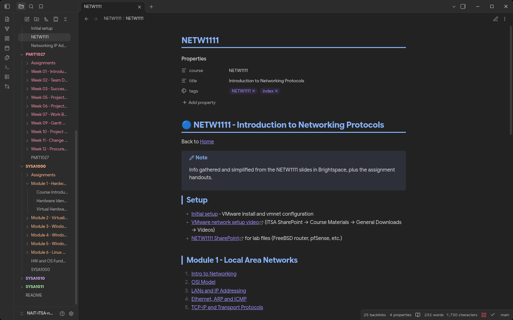
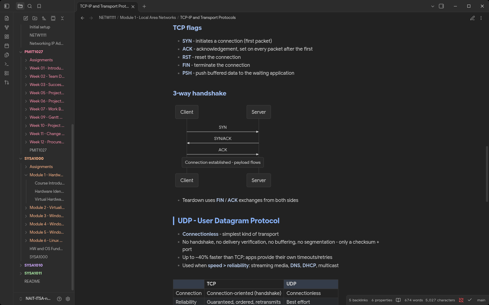
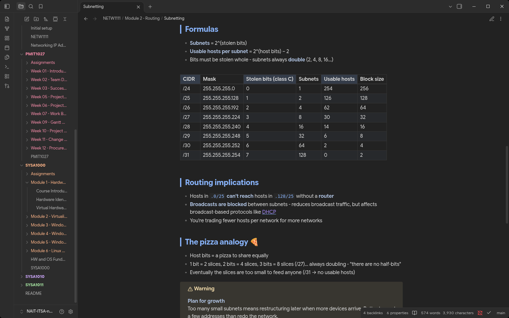
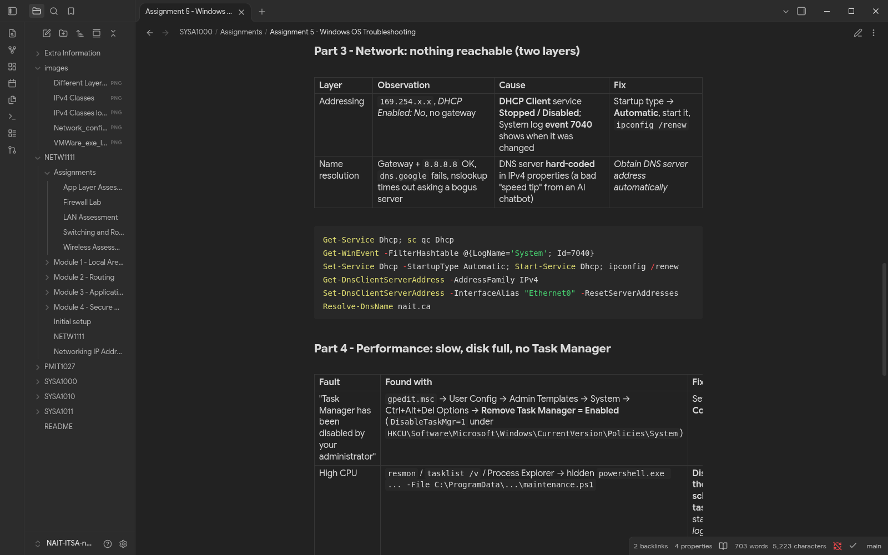
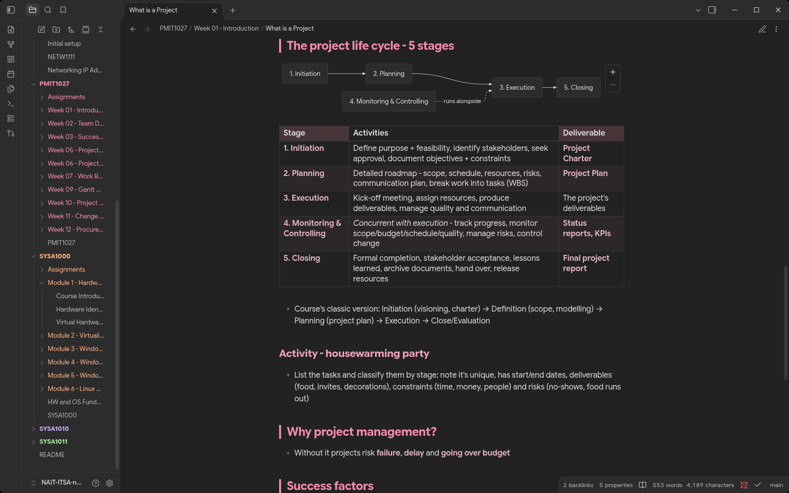
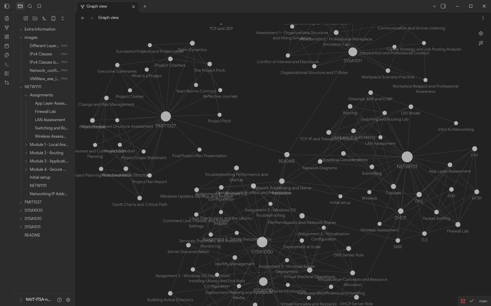

# NAIT ITSA Notes

Personal study notes for the **NAIT IT Systems Administration (ITSA)** diploma, written from the course slides and assignment handouts on Brightspace.

The notes are an [Obsidian](https://obsidian.md) vault, but they're plain Markdown, so you can also read them right here on GitHub.



## Getting started

**Best experience: open the folder as an Obsidian vault.**

```bash
git clone https://github.com/fr3e1/NAIT-ITSA-notes.git
```

Then in Obsidian choose **Open folder as vault** and select `NAIT-ITSA-notes`. Start from any course index below.

> [!NOTE]
> GitHub renders the tables, code blocks and Mermaid diagrams, but the `[[wikilinks]]` between notes show up as plain text. Inside Obsidian everything is linked and rendered.

## Courses - Semester 1 (Fall 2026)

| Course | Title | Contents |
| --- | --- | --- |
| 🔵 [NETW1111](NETW1111/NETW1111.md) | Introduction to Networking Protocols | OSI, IP addressing, subnetting, routing, firewalls, HTTP/FTP/DNS/DHCP/SMB, SSH, TLS, wireless |
| 🟠 [SYSA1000](SYSA1000/SYSA1000.md) | Computer Fundamentals | Hardware, firmware, virtualization, Windows deployment/config/troubleshooting, Ubuntu |
| 🟣 [SYSA1010](SYSA1010/SYSA1010.md) | Introduction to Server Operating Systems | Windows Server, DHCP/DNS roles, shares, Active Directory, GPOs, event logs, documentation |
| 🟢 [SYSA1011](SYSA1011/SYSA1011.md) | Professionalism in the IT Workplace | Org structure, hiring, resumes, ethics, privacy, communication, career strategy |
| 🔴 [PMIT1027](PMIT1027/PMIT1027.md) | IT Project Essentials | Project lifecycle, charters, scope, WBS, Gantt/critical path, RACI, risk, procurement |

Also: [Initial setup](NETW1111/Initial%20setup.md) (VMware install and vmnet configuration) and [Extra Information](Extra%20Information/).

## Color key

Callouts are written as GitHub alerts, so they're colored both here and in Obsidian:

> [!NOTE]
> **Blue - Note / Overview.** Background info, assignment objectives, side notes.

> [!TIP]
> **Green - Tip / Example.** Mnemonics, shortcuts, troubleshooting habits, worked examples.

> [!IMPORTANT]
> **Purple - Key idea.** The thing to remember from the lesson.

> [!WARNING]
> **Yellow - Warning.** Common mistakes and gotchas.

> [!CAUTION]
> **Red - Danger.** Things that can lose data or lock you out.

In Obsidian, each course also has its own [Catppuccin](https://catppuccin.com/palette/) accent color (Mocha in dark mode, Latte in light mode) for headings, tables, bold text, inline code, the file explorer and the graph view, set by the `course-colors` CSS snippet in `.obsidian/snippets/`. It's enabled by default; toggle it in **Settings → Appearance → CSS snippets**.

## Screenshots

<table>
  <tr>
    <td width="50%">
      <br>
      <sub><b>Diagrams</b> - Mermaid sequence diagram of the TCP 3-way handshake</sub>
    </td>
    <td width="50%">
      <br>
      <sub><b>Reference tables and callouts</b> - subnetting cheat sheet</sub>
    </td>
  </tr>
  <tr>
    <td width="50%">
      <br>
      <sub><b>Assignment summaries</b> - faults, causes, fixes and the commands used</sub>
    </td>
    <td width="50%">
      <br>
      <sub><b>Lesson notes</b> - project lifecycle flowchart and stage table</sub>
    </td>
  </tr>
</table>


<sub><b>Graph view</b> - every lesson links back to its course index and to related lessons across courses.</sub>

## Folder layout

```
<COURSE>/
├── <COURSE>.md          course index - start here
├── Module N - .../      lesson notes (Week NN - ... for PMIT1027)
└── Assignments/         assignment and lab summaries
Extra Information/       extra topics outside the course material
images/                  shared images and README screenshots
```

Each note has frontmatter (`course`, `module`, `source`, `tags`) and Prev / Next links so you can read a module straight through.

## Disclaimer

These are personal notes, simplified from NAIT course material. They aren't official NAIT content, and they may contain mistakes. Use them alongside your own course materials, not instead of them.

## License

[MIT](LICENSE)
