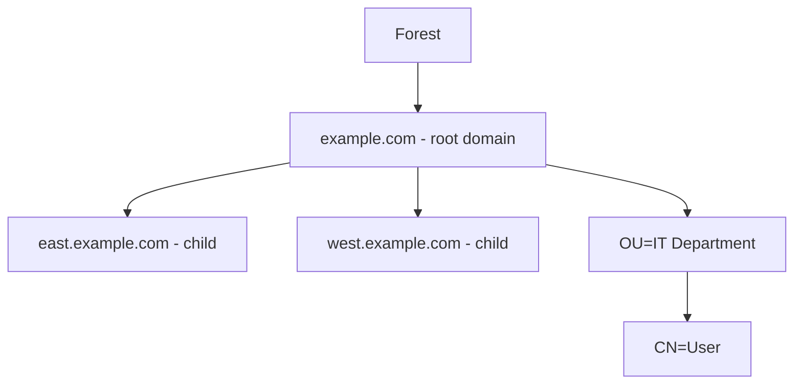

# Identity Management
Back to [[SYSA1010]] · Prev: [[File Permissions and Network Shares]] · Next: [[User Management]]

* **Identity management** = managing user accounts/identities - connecting people, apps and systems through accounts to control access to resources
* **AAA framework**: **Authentication** (who are you?), **Authorization** (what can you do?), **Accounting** (what did you do?)

## Workgroup (decentralized)
* Passwords and profiles not synced; accounts only work on the system they were made on
* No centralized auditing
* Isolated/very small networks only - **not industry best practice**

## Active Directory (centralized)
* Microsoft's centralized identity platform - **one account usable on many systems**
* **OUs** organize users; **groups** grant access; **GPOs** apply uniform configuration
* Needs a **domain name**
* Based on **X.500**; uses **LDAP** (directory queries) and **Kerberos** (authentication)

### Structure
* **Forest** - the security boundary containing the domains
* **Root domain** - the first/top domain in the forest
* **Child domain** - additional domains under it
* **Domain** - contains at least one **domain controller**
* Forests can connect via **trust relationships**



### Tools
* **Active Directory Users and Computers (ADUC)** - users, groups, computers, containers, OUs

### Distinguished names
| Prefix | Object |
| --- | --- |
| `CN=` | Leaf objects (users, groups, computers) **and** built-in containers (`CN=Users`) |
| `OU=` | Organizational units |
| `DC=` | Each part of the domain name |

```
CN=Clayton Amelia Admin,OU=IT Department,DC=Amelia,DC=IT
```

## FSMO roles
| Scope | Role | Job |
| --- | --- | --- |
| Forest (1 per forest) | **Schema Master** | Changes to the AD schema |
| Forest | **Domain Naming Master** | Adding/removing domains |
| Domain (1 per domain) | **RID Master** | Hands out RID pools so SIDs are unique |
| Domain | **PDC Emulator** | Password changes, account lockout, time source |
| Domain | **Infrastructure Master** | Updates cross-domain object references |

```powershell
netdom query fsmo
Get-ADDomain | Select RIDMaster, PDCEmulator, InfrastructureMaster
Get-ADForest | Select SchemaMaster, DomainNamingMaster
```

## Best practices
* Clean OU structure that matches business requirements
* **Least privilege** - secure by design, defense in depth
* A **naming convention** for AD objects
* **Disable unused accounts**
* ⚠️ **A DC can't be renamed** once promoted - name it first
* Isolate server roles

## Local vs domain accounts
| Local | Domain |
| --- | --- |
| Exists/usable on one system | Central, usable on many systems + cloud apps |
| Same name on two PCs = **two different SIDs** | One **central SID** everywhere |

## Security identifiers (SIDs)
* Identify every security principal (user, group, process)
* Issued by the **DC holding the RID Master** role (domain) or the local OS (workgroup)
* Format: **`S-R-X-<domain identifier>-<RID>`**
	* `S` = it's a SID · `R` = revision · `X` = identifier authority · domain ID · **RID** (relative ID, e.g. 500 = Administrator, 1000+ = created accounts)

```powershell
Get-LocalUser | Select Name, SID
Get-ADUser -Filter * | Select Name, SID
```

## References
* [AAA security](https://www.fortinet.com/resources/cyberglossary/aaa-security)
* [Understand security identifiers](https://learn.microsoft.com/en-us/windows-server/identity/ad-ds/manage/understand-security-identifiers)
* Exercise: *05b Deploy Windows Server with Active Directory*
