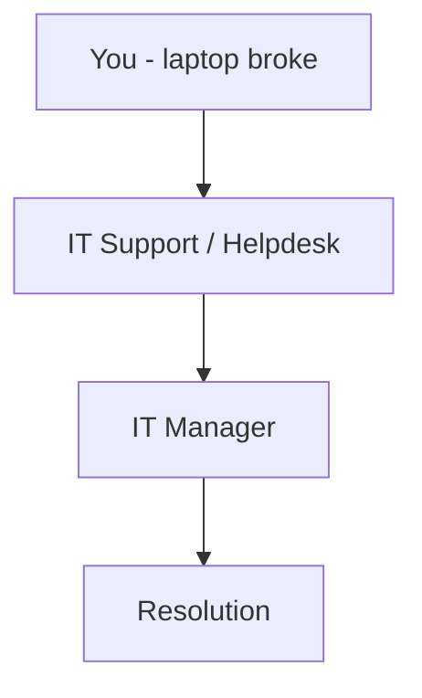
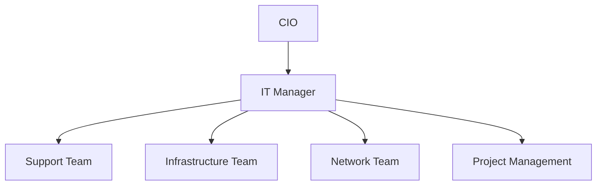

# Organizational Structure and IT Roles
Back to [[SYSA1011]] · Prev: [[Introduction and Professional Conduct]] · Next: [[Hiring Decisions and Candidate Evaluation]]

> [!NOTE]
> Supports [[Assessment 1 - Organizational Structure and Hiring Simulation]]

* Structure isn't just an HR topic - it decides **who can make decisions without approval**, **who you escalate to**, and **how fast requests move**

## How work gets done - escalation

## What an organizational structure defines
1. **Reporting relationships**
2. **Responsibilities**
3. **Decision-making authority**
4. **Communication pathways**

Why: clarifies **accountability**, improves communication, supports growth, helps teams work efficiently.

## How IT departments changed
| Era | IT |
| --- | --- |
| 1960s-1980s | Small **centralized** computing teams managed everything |
| 1990s-2000s | Networks and the internet drove **specialized** roles |
| Today | IT supports nearly every business function: infrastructure, security, applications, strategy |
* **Specialization follows complexity**

## Structure depends on the organization
* NAIT, Amazon, City of Edmonton, Hockey Canada don't need the same IT structure - **size, industry, regulation and mission** change it

## Common areas of an IT department
| Area | Focus |
| --- | --- |
| **Support** | End-user assistance |
| **Infrastructure** | Servers and storage |
| **Networking** | Connectivity and security |
| **Development** | Applications and software |
| **Project Management** | Coordinating initiatives |
| **Leadership** | Strategy and oversight |
* Loosely mirrors **ITIL / ITSM** groupings. Responsibilities often overlap (e.g. backups = infrastructure, but security sets encryption policy)

### Activity - where does it belong?
| Task | Area |
| --- | --- |
| Resetting a password | Support |
| Replacing a failed switch | Networking |
| Building a web app | Development |
| Managing server backups | Infrastructure |
| Approving a technology budget | Leadership |

## Typical IT department

* **CIO** - IT strategy and budget, reports to the CEO/executives; rarely hands-on
* **IT Manager** - turns strategy into operations, manages the teams

## Key IT roles
| Role | Level | Does |
| --- | --- | --- |
| **Helpdesk Technician** | Entry | First contact for user issues; high ticket volume, broad but shallow |
| **Systems Administrator** | Technical | Servers, OSes, storage, backups, virtualization |
| **Network Administrator** | Technical | Switches, routers, firewalls, VPN, wireless |
| **Developer** | Technical | Builds software/applications |
| **Project Manager** | Coordination | Scope, schedule, budget, vendors - delivery, not hands-on tech |
| **IT Manager** | Management | Runs the IT teams day to day |
| **CIO** | Executive | Long-term technology strategy |

### Scenarios
| Scenario | Role |
| --- | --- |
| User can't access email | Helpdesk |
| New branch office needs secure networking, VPN, Wi-Fi | Network Admin |
| Custom app to automate internal requests | Developer |
| Replace aging servers, improve backups | Systems Admin |
| Major deployment across departments, budgets, vendors, schedules | Project Manager |
| Long-term cloud strategy | CIO |

## Reporting relationships
* Establish **responsibility**, **escalation paths**, **accountability**, **decision-making authority**
* The org chart (on paper) and the escalation path (in practice) are the **same structure from two angles**
* Example: Helpdesk → Team Lead → IT Manager → CIO

## Small vs large IT
| Small organization | Large organization |
| --- | --- |
| Wear multiple hats | Specialized roles |
| Informal processes | Formal procedures |
| Smaller budgets | Larger budgets |
| Generalists | Specialists |
* Neither is better - small teams give variety but create single points of failure; large ones give depth but narrower scope

## Case - Northern Trail Manufacturing
* 250 employees, 1 head office + 2 warehouses, ~300 computers, cloud email + ERP, rising cyber threats, **no IT department**
* *Your first four hires:* which roles first, why, who reports to whom, what comes later? What changes at 1,000 employees?
* The skill is **justifying prioritization under constraints**, not naming job titles

## Org charts
* Visualize reporting relationships, leadership, hierarchy, communication pathways
* Clarify responsibilities, support decisions, help people understand the structure
* More than one placement can be defensible (e.g. PM under the IT Manager or beside the technical teams) - **explain why**

## Key takeaways
* Structure supports business operations
* IT departments contain specialized roles
* Reporting relationships create accountability
* Different organizations need different structures
* Understanding roles and hierarchy supports hiring decisions
