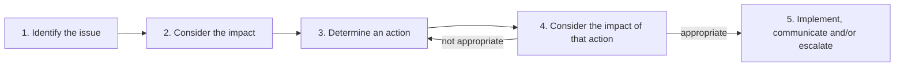

# Privacy, Confidentiality and Workplace Trust
Back to [[SYSA1011]] · Prev: [[LinkedIn and Digital Professionalism]] · Next: [[Organizational IT Resources and Acceptable Use]]

> [!note] The *Privacy, Confidentiality & Workplace Trust* deck in Brightspace only has a title slide, so this note comes from the class summary in `Assessments/SYSA1011`.

> [!important] Core rule
> **Having access to data does not mean you should access it.**

## Privacy vs confidentiality
* **Privacy** - *your* choice about what you share (e.g. giving a website your credit card)
* **Confidentiality** - the *receiver's* duty to keep what you shared secure and only give it to people who need it
* Banks, employers, doctors, schools hold enough (SIN, address, bank numbers, ID, grades) that a breach enables **identity theft**

## Why IT staff are a special case
* Sysadmins can reach passwords/resets, email, shared drives, HR + financial records, student records, customer databases
* **Corporate email belongs to the company** - no expectation of privacy
* At an MSP one script can search and permanently delete an email from every mailbox in a company - powerful; a wrong move destroys trust
* You'll usually be admin on shares because you need rights to manage rights

## Common situations
| Situation | Expectation |
| --- | --- |
| Remote support shows personal/sensitive data | Don't read, comment on or share it - "unsee it" |
| Security incidents | Don't share who caused it or what they did, unless anonymized for training |
| Email investigations | Illegal activity goes only to the investigators; HR/financial/CEO info is off limits |
| Lost devices | Locate, disable, wipe - **be certain it's the right device** |
| Account administration | Password changes/sharing **need authorization** |
* Sharing anonymous, respectful help desk stories is normal; **shaming people for mistakes can count as harassment**
* Class consensus: a tech reading your private email is worse than breaking your PC - *a computer can be fixed, an email can't be unread*

## Decision framework (5 steps)

## Documentation and authorization
* **If it's not in a ticket, it didn't happen.** Verbal authorization isn't authorization
* Tickets give a **timestamped, traceable chain of custody** (traceable, recoverable, authenticatable)
* **Escalate the authorization, not just the task** - you're only accountable to the level you were properly authorized
* Intent doesn't outweigh consequences
* Sometimes the best path is to do nothing or let someone else decide - but still **communicate** it

## Scenarios
| Scenario | Correct move |
| --- | --- |
| Bad share permissions let you see payroll, exec reviews, layoff plans | **Don't open them.** Ticket it. Tell the **data owner** you have access you shouldn't. Get **written authorization** before changing permissions; escalate if you lack authority. Compare against share documentation. Tell the IT manager only if you suspect someone in IT did it deliberately |
| A VP asks you to reset an employee's password and send it to them | **Say no** to the reset. Ask for a **ticket** (identity + paper trail). Verify authority (org chart/HR). Offer **delegated read-only mailbox access** in Exchange Online instead. Document everything |
| Audit finds a former employee's account active 3 months after they left | Urgent, high impact. Report to manager **and HR**. With HR authorization disable it, give the right people access to the data via their own accounts. Ticket + escalate |

## Case study - privileged insider
* A social media company employee allegedly used **legitimate** privileged access to download ~30,000 private photos → criminal investigation
* Not weak security - **misuse of valid access**
* Mitigations: better **vetting**, **accounting/logging**, **monitoring** that flags large downloads early
* People with privileged access are held to a **higher standard**

## Privacy laws
| Law | Scope |
| --- | --- |
| **PIPEDA** | Canada - private sector organizations |
| **Privacy Act** | Canada - federal government bodies |
| **Alberta** | **PIPA** covers private organizations. For public bodies (like NAIT), **FOIP was replaced** by the *Access to Information Act* and the *Protection of Privacy Act* (in force June 2025, compliance by June 2026) - stricter, digital-focused |
| **GDPR** (EU) | Applies to any site reachable from the EU → affects Canadian sites. **Non-essential cookies** (analytics, ads, tracking) need **explicit consent**; essential cookies (login, cart) are exempt. Evolved from the 2002 e-Privacy Directive (2009 amendment → "implied consent" cookie banners) |

## Study checklist
- [ ] Define privacy vs confidentiality with an example
- [ ] Explain why access ≠ permission
- [ ] Apply the 5-step framework
- [ ] Walk through the VP reset, share permission and former-employee scenarios
- [ ] Explain why tickets matter (accountability, authentication, chain of custody)
- [ ] Know PIPEDA, the Privacy Act, Alberta's acts, and why GDPR matters to Canadians
